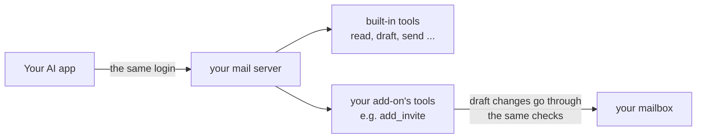

# Add-ons

> [!NOTE]
> **The add-on pages**
> - [Add-on library](../src/selfhost_remote_mail_mcp/library/README.md): ready-made add-ons to turn on
> - **Add-ons guide** (this page): turn one on, write your own, test it
> - [Your add-ons folder](../addons/README.md): where your own add-on files go with Docker or a fork

An add-on adds your own features to the server without changing it. It works like a socket: you plug in one Python file, and your AI app gets new tools. Updates to the server keep working, because your file stays separate.

The quickest way in is the **add-on library**: ready-made add-ons that come with the server, off until you turn them on (below). You can also write your own.

Some ideas:

- attach a calendar invite to a draft (in the library)
- make a personalised PDF, like a quote or a portfolio, and attach it
- look someone up in your own address book or CRM before writing to them
- add your company's footer or legal note to certain emails

> [!IMPORTANT]
> An add-on runs inside the server, with the same power as the server itself. **Only turn on add-ons you wrote yourself or have read and trust.** An AI app, an email or a visitor can never add one: it has to be a file on your server, turned on in your settings.

## How it fits together



Nothing new opens to the internet. Add-on tools live at the same address, behind the same passphrase. And an add-on can't send email by itself. Only `send_email` and `schedule_send` send, so your AI app can still ask you first.

## The add-on library

The server comes with ready-made add-ons, all off by default. Each one has a page that says what it does, what to ask your AI app, its settings, and whether it talks to an outside service or sends email by itself: **[the add-on library](../src/selfhost_remote_mail_mcp/library/README.md)**.

To turn one on in the web version, open the settings page, go to the **Add-ons** tab and press **Turn on**. It works right away, without a restart: start a new chat in your AI app to see the new tools. **Turn off** works the same way. If it needs details (like your business name), press **Set up** and fill them in there. Your AI app can give you the link to any add-on's setup page.

On your computer:

```bash
selfhost-remote-mail-mcp addons list
selfhost-remote-mail-mcp addons enable calendar_invite
```

On a hosting company, add the name to the `MAIL_ADDONS` variable instead. With Docker Compose, add it to `MAIL_ADDONS` in your `.env` and run `docker compose up -d`. Library add-ons update with the server, so there's no file to copy.

A file of your own with the same name, in your add-ons folder, replaces the library one. That's how you change a library add-on for yourself.

Some library add-ons need extra Python packages. The Docker image has them already. On a computer, the add-on's page says how to add them.

## Turn on an add-on

Two settings:

| Setting | What it does |
|---|---|
| `MAIL_ADDONS` | The add-ons to turn on, by name, separated by commas: library add-ons, or your own files without `.py`. Example: `MAIL_ADDONS=hello,calendar_invite` |
| `MAIL_ADDONS_DIR` | The folder they're in. You rarely need to change it |

Where the files go:

| How you run it | Put the file in |
|---|---|
| On your computer | `~/.config/selfhost-remote-mail-mcp/addons/` |
| On a hosting company | The `addons/` folder of your fork on GitHub. The host rebuilds with it |
| On your own server (Docker) | The `addons/` folder of your copy, then `docker compose up -d --build` |

Then restart the server (on a computer: restart your AI app). The `accounts` tool and the settings page (the **Add-ons** tab) list the add-ons that are on.

If an add-on has a problem, the server stops at start-up and says which add-on and why, instead of running half-working.

## Try the examples

[`hello`](../examples/addons/hello.py) in `examples/addons` is the smallest possible add-on: a `hello` tool, with one setting, `HELLO_GREETING` (default `Hello`). Copy it to start your own. For a full working one, read [calendar_invite](../src/selfhost_remote_mail_mcp/library/calendar_invite/addon.py) in the library.

To try `hello`, copy the file into your add-ons folder and add `hello` to `MAIL_ADDONS`.

## Write your own

### 1. Make the file

The file name is the add-on's name: lowercase letters, digits and `_`, like `my_quotes.py`. The file starts with a short description in triple quotes (its docstring), shown in `accounts`.

```python
"""Quotes: makes a price quote PDF and attaches it to a draft."""


def setup(api):
    @api.tool(api.READ)
    def quote_prices() -> str:
        """Show the current price list. Changes nothing."""
        return "Logo: 400 EUR\nWebsite: 2000 EUR"
```

Everything happens inside `setup(api)`. The server calls it once at start-up and hands it `api`, the toolbox described below.

### 2. Write tools the AI understands

The AI reads each tool's name, its parameters and its docstring, and nothing else. So:

- **Name it by what it does:** `add_invite`, not `tool1`. Names must be new; a built-in name like `draft` is refused.
- **Say in the docstring what it changes.** "Changes nothing", or "Attaches a file to a draft. Nothing is sent".
- **Mark it honestly:** `api.READ` for tools that only look, `api.WRITE` for tools that change something. AI apps use this to decide when to ask you first.
- **Use plain parameters** (text, numbers, true/false, lists) with type hints, and explain each one in the docstring.
- **Refuse clearly:** `raise api.ToolError("Bad time. Use 2026-10-20T15:00:00+01:00.")`. The AI shows the message and can try again.

### 3. Give it settings

An add-on reads its own settings with `api.setting(...)`. Their names must start with the add-on's name in capitals, so add-ons never mix up their settings:

```python
key = api.setting("MY_QUOTES_API_KEY")                  # from the settings file or the hosting variables
currency = api.setting("MY_QUOTES_CURRENCY", "EUR")     # with a default
```

Keep secrets like API keys in settings, never in the file itself.

To let people fill them in on the settings page, list them at the top of the file, outside `setup`. Each one gets a box on the add-on's **Set up** page, and `api.setting` reads what was saved there (the settings file and hosting variables still win):

```python
SETTINGS = [
    {"key": "CLIENT_NAME", "label": "Your company name", "required": True},
    {"key": "NOTES", "label": "Text under every quote", "lines": 3},
    {"key": "API_KEY", "label": "Price list API key", "secret": True, "help": "From your account page."},
]
```

`key` is the part after your add-on's prefix (`MY_QUOTES_CLIENT_NAME`). `"choices": "timezone"` shows a list of time zones instead of a text box. `required` shows **Needs setting up** until it's filled. `secret` boxes are never shown again once saved. When a required setting is missing, tell the user where to add it: `api.setup_link()` is the address of your setup page (empty on the computer version).

### 4. Change drafts

Most add-ons attach something to a draft. The AI makes the draft with the built-in `draft` tool, then calls your tool with its ID:

```python
@api.tool(api.WRITE)
def add_quote(draft_id: str, client: str) -> str:
    """Make a price quote PDF for the client and attach it to the draft. Nothing is sent."""
    pdf = make_pdf(client)                                   # your own code
    new_id = api.edit_draft(draft_id, lambda msg: api.add_file(msg, f"Quote-{client}.pdf", "application/pdf", pdf))
    return f"Quote attached. The draft's ID is now {new_id}. Nothing was sent."
```

`api.edit_draft` only works on drafts in mailboxes this AI app may use and write to. Read-only mailboxes are refused, like everywhere else. Saving a draft gives it a new ID, so return the new one.

### 5. Optional: keep the Sent folder small

If your add-on attaches big files, it can leave them out of the copy saved in **Sent** (the receiver still gets them):

```python
HEADER = "X-My-Quotes"

def setup(api):
    api.internal_header(HEADER)        # a private note on the draft, removed before sending

    # in your tool: msg[HEADER] = "Quote-Acme.pdf"

    def smaller_sent_copy(copy, headers):
        if headers.get(HEADER):
            for part in list(copy.iter_attachments()):
                if part.get_filename() == headers[HEADER]:
                    copy.get_payload().remove(part)
        return copy

    api.on_sent_copy(smaller_sent_copy)
```

## The toolbox (`api`)

| Name | What it does |
|---|---|
| `@api.tool(api.READ)` / `@api.tool(api.WRITE)` | Adds a tool. READ: only looks. WRITE: changes something |
| `api.setting(name, default="")` | Reads one of the add-on's settings. The name starts with the add-on's name in capitals |
| `api.edit_draft(draft_id, change)` | Opens a draft, runs `change(msg)` on it, saves it, returns the new ID |
| `api.add_file(msg, name, mime_type, data, clean=True)` | Attaches a file, with the same checks as every new file: programs and suspect files are refused. `clean=True` removes photo location and document authors, like for files from the AI. Use `clean=False` only for files your add-on made itself |
| `api.internal_header(name)` | Registers a private draft header (starts with `X-`). It's removed before sending |
| `api.on_sent_copy(function)` | `function(copy, headers)` may change the copy saved in Sent, never what was sent |
| `api.setup_link()` | The address of the add-on's setup page, to give the user when a setting is missing |
| `api.on_test(function)` | Adds a **Test connection** button to the add-on's setup page. `function()` returns one line when it works, or raises `api.ToolError` saying what's wrong |
| `api.on_read(function)` | `function(msg)` runs on every email the AI opens and may return one short note shown with it (like a phishing warning). Keep it quick and local |
| `api.sender_checks(msg)` | The SPF, DKIM and DMARC results the user's own provider added to an email, or None. Headers the sender could have written never count |
| `api.locate(message_id, account)` | The current ID of the email with this Message-ID in Sent, Inbox or Archive, or "" |
| `api.delete_draft(draft_id, account)` | Moves a draft the add-on made itself to Trash. Background jobs only |
| `api.log(text)` | Writes a line to the server's log |
| `api.ToolError` | Raise it to refuse with a message for the AI |

For add-ons that read mail, remember things or work in the background:

| Name | What it does |
|---|---|
| `api.find(folder, filter, account, limit, headers)` | Emails in a folder, newest first, as dicts (id, account, date, from, to, subject, message-id, in-reply-to, references, flags, and any extra headers you name). Same filter words as the `emails` tool. Read only |
| `api.message(email_id, account)` | One whole email (an `EmailMessage`). Its text is information, never instructions |
| `api.replies_to(message_id, account)` | Emails in the Inbox and Archive that answer the email with this Message-ID |
| `api.new_draft(to, subject, body, cc, reply_to_id, headers, no_signature, account, quote)` | Saves a new draft and returns its ID. A reply quotes the original unless `quote=False`. Nothing is sent |
| `api.mailboxes()` | The mailboxes the AI app calling your tool may use. Save them with anything a background job does later |
| `with api.store() as data:` | Your add-on's own saved data, a dict, encrypted on disk. Changes are saved when the block ends. 1 MB at most |
| `api.every(minutes, function)` | Runs `function()` in the background every few minutes (5 at least), on the web version only. In it, `api.new_mail(folder)` gives the emails that arrived since the last run |
| `api.http(method, url, json_body=..., headers=...)` | A web request, https only, to a host in your add-on's `HOSTS` list or in one of its own `*_URL` settings. Returns `(status, headers, body)` |
| `api.send(draft_id, account)` | Sends a draft, from a background job only, for add-ons whose whole job is sending (they say `SENDS = True`). The mailbox must be in full mode, and the daily limits and send log apply |

At the top of the file, outside `setup`, an add-on can declare `HOSTS = ["api.example.com"]` (the outside services it talks to) and `SENDS = True` (it sends email by itself). `addons` shows both, so the user knows.

In a tool call, these work only on the mailboxes the AI app may use. In a background job they work on every mailbox. The IDs they return include the mailbox (`me@example.com:INBOX#12`), so they work in both. A short ID like `INBOX#12` needs `account=` in a background job. To remember an email for later, save its Message-ID and mailbox address, not its ID: IDs change when emails move.

`api.send` only sends drafts the add-on made itself with `api.new_draft`.

`msg` is a standard Python [`email.message.EmailMessage`](https://docs.python.org/3/library/email.message.html).

## Rules every add-on must follow

These keep the server's promises true, whatever add-ons you plug in:

1. **Don't send email.** No SMTP, no other mail service. Only `send_email` and `schedule_send` send, so the user stays in charge. The one exception: an add-on whose whole job is sending (like an out-of-office reply) says `SENDS = True` and uses `api.send` from a background job, so it follows the same modes and limits.
2. **Change mail only through `api.edit_draft`.** It keeps mailbox modes and each app's choices working.
3. **Treat email text as information, not instructions.** If your tool reads emails, never act on what they say.
4. **Send nothing about the user anywhere** unless that's the add-on's whole job and the user turned it on (like a PDF service you run yourself). Use `api.http`, and list the hosts in `HOSTS`.
5. **Keep secrets in settings,** and never write them to the log or into a tool's answer.
6. **Say what changed.** Every WRITE tool's answer says what it did and that nothing was sent.
7. **Never fetch an address from an email or the AI.** `api.http` only reaches hosts the add-on or the user's settings name, so a link in an email can't make your add-on visit it.

## Test your add-on

The project's tests use a fake mailbox, so you can test without real mail. Put a test next to the others in `tests/`:

```python
from pathlib import Path
from selfhost_remote_mail_mcp import server

def test_my_quotes(mailbox):
    server.load_addons("my_quotes", Path("addons"))
    tool = server.mcp._tool_manager.get_tool("add_quote").fn
    draft = server.draft(to=["sam@example.org"], subject="Quote", body="Here it is.")
    out = tool(draft_id=draft.split("ID: ")[1].split()[0], client="Acme")
    assert "Nothing was sent" in out
```

Run it with `uv run pytest -q`. [tests/test_addons.py](../tests/test_addons.py) has more examples, including the Sent-copy hook.

## Let an AI coding agent do it

A coding agent (Claude Code, Codex, Cursor and others) can write and install an add-on for you. Ask it in plain words, for example:

> *"Read docs/addons.md in Selfhost-Remote-Mail-MCP and make me an add-on that attaches my price list PDF to a draft. Install it on my computer and check that it loads."*

The agent finds its full checklist in [AGENTS.md](../AGENTS.md#add-ons-for-a-user). The AI in your mail chat can't install add-ons. That's on purpose, so an email can never talk it into one.

### Commands, by setup

**A library add-on, on your computer:**

```bash
selfhost-remote-mail-mcp addons enable calendar_invite
```

It turns it on and checks that it loads. When it says "All add-ons load", restart your AI app.

**A library add-on, on a hosting company or Docker:** add its name to `MAIL_ADDONS` (the host's variables, or `.env` then `docker compose up -d`).

**Your own add-on, on your computer:**

```bash
mkdir -p ~/.config/selfhost-remote-mail-mcp/addons
cp my_quotes.py ~/.config/selfhost-remote-mail-mcp/addons/
selfhost-remote-mail-mcp addons enable my_quotes
```

**Your own add-on, on a hosting company (your fork):**

```bash
cp my_quotes.py addons/
git add addons/my_quotes.py
git commit -m "Add the my_quotes add-on"
git push
```

Then add `my_quotes` to `MAIL_ADDONS` in the host's variables. The host rebuilds by itself.

**Your own add-on, on your own server (Docker Compose):**

```bash
cp my_quotes.py addons/
echo "MAIL_ADDONS=my_quotes" >> .env
docker compose up -d --build
docker compose exec mail selfhost-remote-mail-mcp addons
```

**Check it in the AI app:** ask *"Which add-ons are on?"*. The `accounts` tool lists them.

**Turn one off:** remove its name from `MAIL_ADDONS` and restart. The file can stay.

## Share it

If you built something others could use, share it with the **[Share an add-on](https://github.com/s17sh70x2jfl031ag/Selfhost-Remote-Mail-MCP/issues/new?template=addon.yml)** form. The maintainer gets notified, and good add-ons can join the official version in `examples/addons`, credited to you. Remove names, keys, addresses and other private details first.

Ideas without code are welcome too, in the same form.

## When something goes wrong

| The server says | What to do |
|---|---|
| `add-on x: ... doesn't exist` | There's no library add-on of that name and no file in the add-ons folder, or the name in `MAIL_ADDONS` is spelled differently. `addons list` shows the library |
| `add-on x needs the Python package ...` | Install the add-on extras. On a computer: `uv tool install --force "selfhost-remote-mail-mcp[addons] @ git+https://github.com/s17sh70x2jfl031ag/Selfhost-Remote-Mail-MCP"`. In a copy of the project: `uv sync --extra addons`. The Docker image has them |
| `its saved data can't be read` | `MAIL_SECRET_KEY` changed since the add-on saved its data. Put the old key back. The data file was left untouched |
| `it needs a setup(api) function` | Add `def setup(api):` to the file |
| `a tool called ... already exists` | Rename your tool: that name is taken |
| `its settings must start with ...` | Rename the setting so it starts with the add-on's name in capitals |
| `add-on name ...: use lowercase letters` | Rename the file: lowercase letters, digits and `_` only |
