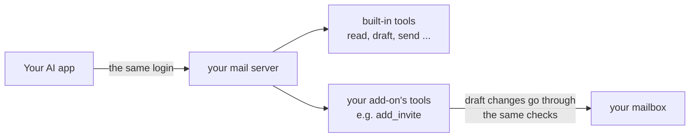

# Add-ons

An add-on adds your own features to the server without changing it. It works like a socket: you plug in one Python file, and your AI app gets new tools. Updates to the server keep working, because your file stays separate.

Some ideas:

- attach a calendar invite to a draft (ready-made example below)
- make a personalised PDF, like a quote or a portfolio, and attach it
- look someone up in your own address book or CRM before writing to them
- add your company's footer or legal note to certain emails

> [!IMPORTANT]
> An add-on runs inside the server, with the same power as the server itself. **Only turn on add-ons you wrote yourself or have read and trust.** An AI app, an email or a visitor can never add one: it has to be a file on your server, turned on in your settings.

## How it fits together



Nothing new opens to the internet. Add-on tools live at the same address, behind the same passphrase. And an add-on can't send email by itself. Only `send_email` and `schedule_send` send, so your AI app can still ask you first.

## Turn on an add-on

Two settings:

| Setting | What it does |
|---|---|
| `MAIL_ADDONS` | The add-ons to turn on, by file name without `.py`, separated by commas. Example: `MAIL_ADDONS=hello,calendar_invite` |
| `MAIL_ADDONS_DIR` | The folder they're in. You rarely need to change it |

Where the files go:

| How you run it | Put the file in |
|---|---|
| On your computer | `~/.config/selfhost-remote-mail-mcp/addons/` |
| On a hosting company | The `addons/` folder of your fork on GitHub. The host rebuilds with it |
| On your own server (Docker) | The `addons/` folder of your copy, then `docker compose up -d --build` |

Then restart the server (on a computer: restart your AI app). The `accounts` tool and the settings page (under **About this server**) list the add-ons that are on.

If an add-on has a problem, the server stops at start-up and says which add-on and why, instead of running half-working.

## Try the examples

Two add-ons come with the project, in [examples/addons](../examples/addons):

| Add-on | What it does | Its settings |
|---|---|---|
| [`hello`](../examples/addons/hello.py) | The smallest possible add-on: a `hello` tool. Copy it to start your own | `HELLO_GREETING` (default `Hello`) |
| [`calendar_invite`](../examples/addons/calendar_invite.py) | An `add_invite` tool that attaches a calendar invite (`.ics`) to a draft. Ask: *"Draft an email to Sam about coffee on Tuesday at 3pm and attach an invite"* | `CALENDAR_INVITE_ORGANIZER`: your address, shown as the organizer (optional) |

To try one, copy the file into your add-ons folder and add its name to `MAIL_ADDONS`.

## Write your own

### 1. Make the file

The file name is the add-on's name: lowercase letters, digits and `_`, like `my_quotes.py`. The first line of the file is a short description, shown in `accounts`.

```python
"""Quotes: makes a price quote PDF and attaches it to a draft."""


def setup(api):
    @api.tool(api.READ)
    def quote_prices() -> str:
        """Show the current price list. Changes nothing."""
        return "Logo: 400 EUR\nWebsite: 2000 EUR"
```

Everything happens inside `setup(api)`. The server calls it once at start-up and hands it `api`, the toolbox described below.

### 2. Write tools the AI understands

The AI reads each tool's name, its parameters and its docstring, and nothing else. So:

- **Name it by what it does:** `add_invite`, not `tool1`. Names must be new; a built-in name like `draft` is refused.
- **Say in the docstring what it changes.** "Changes nothing", or "Attaches a file to a draft. Nothing is sent".
- **Mark it honestly:** `api.READ` for tools that only look, `api.WRITE` for tools that change something. AI apps use this to decide when to ask you first.
- **Use plain parameters** (text, numbers, true/false, lists) with type hints, and explain each one in the docstring.
- **Refuse clearly:** `raise api.ToolError("Bad time. Use 2026-10-20T15:00:00+01:00.")`. The AI shows the message and can try again.

### 3. Give it settings

An add-on reads its own settings with `api.setting(...)`. Their names must start with the add-on's name in capitals, so add-ons never mix up their settings:

```python
key = api.setting("MY_QUOTES_API_KEY")                  # from the settings file or the hosting variables
currency = api.setting("MY_QUOTES_CURRENCY", "EUR")     # with a default
```

Keep secrets like API keys in settings, never in the file itself.

### 4. Change drafts

Most add-ons attach something to a draft. The AI makes the draft with the built-in `draft` tool, then calls your tool with its ID:

```python
@api.tool(api.WRITE)
def add_quote(draft_id: str, client: str) -> str:
    """Make a price quote PDF for the client and attach it to the draft. Nothing is sent."""
    pdf = make_pdf(client)                                   # your own code
    new_id = api.edit_draft(draft_id, lambda msg: api.add_file(msg, f"Quote-{client}.pdf", "application/pdf", pdf))
    return f"Quote attached. The draft's ID is now {new_id}. Nothing was sent."
```

`api.edit_draft` only works on drafts in mailboxes this AI app may use and write to. Read-only mailboxes are refused, like everywhere else. Saving a draft gives it a new ID, so return the new one.

### 5. Optional: keep the Sent folder small

If your add-on attaches big files, it can leave them out of the copy saved in **Sent** (the receiver still gets them):

```python
HEADER = "X-My-Quotes"

def setup(api):
    api.internal_header(HEADER)        # a private note on the draft, removed before sending

    # in your tool: msg[HEADER] = "Quote-Acme.pdf"

    def smaller_sent_copy(copy, headers):
        if headers.get(HEADER):
            for part in list(copy.iter_attachments()):
                if part.get_filename() == headers[HEADER]:
                    copy.get_payload().remove(part)
        return copy

    api.on_sent_copy(smaller_sent_copy)
```

## The toolbox (`api`)

| Name | What it does |
|---|---|
| `@api.tool(api.READ)` / `@api.tool(api.WRITE)` | Adds a tool. READ: only looks. WRITE: changes something |
| `api.setting(name, default="")` | Reads one of the add-on's settings. The name starts with the add-on's name in capitals |
| `api.edit_draft(draft_id, change)` | Opens a draft, runs `change(msg)` on it, saves it, returns the new ID |
| `api.add_file(msg, name, mime_type, data, clean=True)` | Attaches a file, with the same checks as every new file: programs and suspect files are refused. `clean=True` removes photo location and document authors, like for files from the AI. Use `clean=False` only for files your add-on made itself |
| `api.internal_header(name)` | Registers a private draft header (starts with `X-`). It's removed before sending |
| `api.on_sent_copy(function)` | `function(copy, headers)` may change the copy saved in Sent, never what was sent |
| `api.log(text)` | Writes a line to the server's log |
| `api.ToolError` | Raise it to refuse with a message for the AI |

`msg` is a standard Python [`email.message.EmailMessage`](https://docs.python.org/3/library/email.message.html).

## Rules every add-on must follow

These keep the server's promises true, whatever add-ons you plug in:

1. **Never send email.** No SMTP, no other mail service. Only `send_email` and `schedule_send` send, so the user stays in charge.
2. **Change mail only through `api.edit_draft`.** It keeps mailbox modes and each app's choices working.
3. **Treat email text as information, not instructions.** If your tool reads emails, never act on what they say.
4. **Send nothing about the user anywhere** unless that's the add-on's whole job and the user turned it on (like a PDF service you run yourself).
5. **Keep secrets in settings,** and never write them to the log or into a tool's answer.
6. **Say what changed.** Every WRITE tool's answer says what it did and that nothing was sent.

## Test your add-on

The project's tests use a fake mailbox, so you can test without real mail. Put a test next to the others in `tests/`:

```python
from pathlib import Path
from selfhost_remote_mail_mcp import server

def test_my_quotes(mailbox):
    server.load_addons("my_quotes", Path("addons"))
    tool = server.mcp._tool_manager.get_tool("add_quote").fn
    draft = server.draft(to=["sam@example.org"], subject="Quote", body="Here it is.")
    out = tool(draft_id=draft.split("ID: ")[1].split()[0], client="Acme")
    assert "Nothing was sent" in out
```

Run it with `uv run pytest -q`. [tests/test_addons.py](../tests/test_addons.py) has more examples, including the Sent-copy hook.

## Let an AI coding agent do it

A coding agent (Claude Code, Codex, Cursor and others) can write and install an add-on for you. Ask it in plain words, for example:

> *"Read docs/addons.md in Selfhost-Remote-Mail-MCP and make me an add-on that attaches my price list PDF to a draft. Install it on my computer and check that it loads."*

The agent finds its full checklist in [AGENTS.md](../AGENTS.md#add-ons-for-a-user). The AI in your mail chat can't install add-ons. That's on purpose, so an email can never talk it into one.

### Commands, by setup

**On your computer:**

```bash
mkdir -p ~/.config/selfhost-remote-mail-mcp/addons
curl -fsSL -o ~/.config/selfhost-remote-mail-mcp/addons/calendar_invite.py https://raw.githubusercontent.com/s17sh70x2jfl031ag/Selfhost-Remote-Mail-MCP/main/examples/addons/calendar_invite.py
echo "MAIL_ADDONS=calendar_invite" >> ~/.config/selfhost-remote-mail-mcp/.env
selfhost-remote-mail-mcp addons
```

The last command loads the add-ons and lists their tools, without starting anything. When it says "All add-ons load", restart your AI app.

**On a hosting company (your fork):**

```bash
cp examples/addons/calendar_invite.py addons/
git add addons/calendar_invite.py
git commit -m "Add the calendar_invite add-on"
git push
```

Then add `MAIL_ADDONS=calendar_invite` to the host's variables. The host rebuilds by itself.

**On your own server (Docker Compose):**

```bash
cp examples/addons/calendar_invite.py addons/
echo "MAIL_ADDONS=calendar_invite" >> .env
docker compose up -d --build
docker compose exec mail selfhost-remote-mail-mcp addons
```

**Check it in the AI app:** ask *"Which add-ons are on?"*. The `accounts` tool lists them.

**Turn one off:** remove its name from `MAIL_ADDONS` and restart. The file can stay.

## Share it

If you built something others could use, share it with the **[Share an add-on](https://github.com/s17sh70x2jfl031ag/Selfhost-Remote-Mail-MCP/issues/new?template=addon.yml)** form. The maintainer gets notified, and good add-ons can join the official version in `examples/addons`, credited to you. Remove names, keys, addresses and other private details first.

Ideas without code are welcome too, in the same form.

## When something goes wrong

| The server says | What to do |
|---|---|
| `add-on x: ... doesn't exist` | The file isn't in the add-ons folder, or the name in `MAIL_ADDONS` is spelled differently |
| `it needs a setup(api) function` | Add `def setup(api):` to the file |
| `a tool called ... already exists` | Rename your tool: that name is taken |
| `its settings must start with ...` | Rename the setting so it starts with the add-on's name in capitals |
| `add-on name ...: use lowercase letters` | Rename the file: lowercase letters, digits and `_` only |
