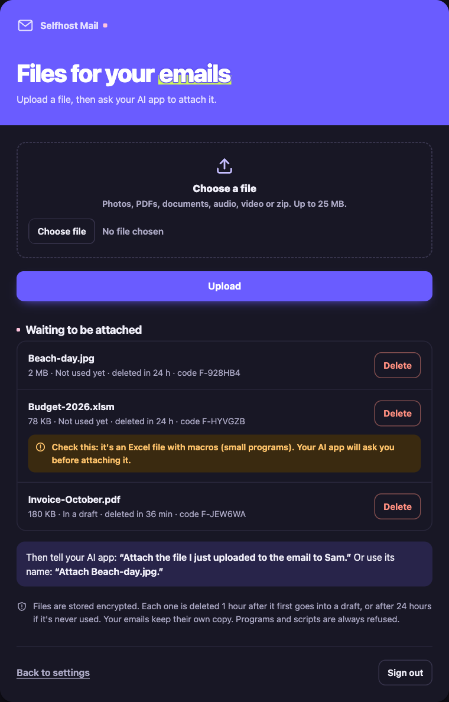

# Attaching files

Your AI can attach files to drafts in four ways:

| Where the file is | Say something like | Works on |
|---|---|---|
| In another email | *"Attach the PDF from Sam's email"* or *"Forward this with its attachments"* | Every version |
| On your computer | *"Attach ~/Desktop/invoice.pdf"* | The computer version only |
| Written by the AI | *"Put the list in a CSV and attach it"* | Every version (up to 2 MB per file) |
| On your phone or anywhere else | Upload it on the upload page, then *"Attach the photo I just uploaded"* | The web version |

Each email can carry up to **25 MB** of files (`ATTACH_MAX_MB`), which is what most providers accept.

## The upload page

1. Open `https://your-address/upload` on your phone or computer and type your passphrase.
2. Choose a file and press **Upload**.
3. Tell your AI app: *"Attach the file I just uploaded to the email to Sam."* Or use its name: *"Attach Beach-day.jpg."*

The AI can also see the list of waiting files, so you can ask *"Which files did I upload?"* and it tells you before attaching. If two files have similar names, it asks which one you mean. Each file also has a short code (like `F-7Q2KMX`), only needed if names get confusing.

**How long files stay:**

- **1 hour** after a file first goes into a draft. The draft has its own copy by then, so you can still send it later.
- **24 hours** if it's never used.
- Or right away, when you press **Delete**.

Up to 20 files can wait at once. Delete some to upload more.

Files on the server are stored encrypted, with the same key as the mailbox passwords (`MAIL_SECRET_KEY`). The page only exists on the web version, behind your passphrase. `UPLOAD_PAGE=off` removes it.

## Which files are allowed

The server looks at what's actually inside each file, not only its name.

**✅ Safe:** attached right away.

| Kind | Types |
|---|---|
| Photos | jpg, png, gif, webp, heic, heif, tiff, bmp, avif |
| PDF | pdf |
| Documents | docx, xlsx, pptx, Pages, Numbers, Keynote, odt, ods, odp, txt, csv, rtf, md, epub |
| Audio and video | mp3, m4a, wav, aac, mp4, mov |
| Calendar and contacts | ics, vcf |
| Emails | eml |
| Archives | zip, tar.gz (the files inside are checked too) |

**⚠️ Suspect:** attached only after you say yes.

| File | Why |
|---|---|
| doc, xls, ppt, docm, xlsm, pptm, or any Office file with macros inside | Macros are small programs |
| PDFs with code or hidden files inside | They can run actions when opened |
| svg, html | They can hold scripts |
| zip with a password, rar, 7z | The server can't look inside |
| zip with unusual files inside | The server doesn't know those types |

**⛔ Blocked:** always refused.

- Programs and scripts: exe, msi, app, dmg, pkg, apk, bat, cmd, ps1, sh, js, vbs, jar, scr, lnk, iso, py and similar.
- A file whose content doesn't match its name, like a program called `photo.jpg`.
- A file name with hidden characters that make `gpj.exe` look like `exe.jpg`.
- A zip or tar.gz with any of the above inside.
- Any type not listed on this page.

## What happens with a suspect file

1. The AI tries to attach it. The server saves nothing and tells the AI why the file is suspect.
2. The AI tells you the reason and asks if you still want it attached.
3. If you say yes, the AI tries again with your OK, and the draft is saved.
4. The AI may suggest a line you could add for the receiver, like *"budget.xlsm contains macros, that's expected."* You decide whether to add it.

The server never adds a warning to your email. Mail providers like Gmail, Outlook and iCloud already scan attachments and warn their users, and an extra warning line can make your email look like spam.

On the upload page, a suspect file gets a yellow **Check this** label with the reason.

## Files from your computer

This only works when the server runs on your own computer (`stdio`), since a server online can't see your files. To keep a tricked AI from sending your private files:

- Only files in your home folder are allowed. Set `ATTACH_FOLDERS` to allow other folders, or fewer: `ATTACH_FOLDERS=~/Documents,~/Desktop`.
- Hidden files and folders (`.ssh`, `.env`, `.config` ...) are never attached, nor anything in the server's own folders.
- Folders can't be attached. Compress them into a .zip first.
- The usual sending rules still apply: the AI only drafts, and you decide when it's sent.

On a Mac, Pages, Numbers and Keynote files are sometimes folders in disguise. If one is refused as a folder, use **File → Export To** or compress it.

## Private details are removed

Before a new file is attached, the server removes details you may not want to share. The file itself looks the same.

| File | What's removed | What stays |
|---|---|---|
| jpg, png, webp photos | The place it was taken (GPS), the camera, dates and comments | The picture and its rotation |
| Word, Excel, PowerPoint, OpenDocument | The author, who last edited it, company and manager | All the content, including the title |
| PDF | The author and the apps that made it | The pages and the title. Signed or locked PDFs are left alone, because changing them would break the signature |

- The draft summary says what was removed, like *"beach.jpg: removed location and camera details"*.
- **iPhone photos (HEIC)** keep their location unless you change them to JPG (below). avif and tiff photos can't be cleaned here; the AI tells you when one may still hold its location.
- Files forwarded from other emails stay as they are, because they belong to someone else.
- Both are on by default. Turn them off under **Privacy** on the settings page, or with `REMOVE_PHOTO_LOCATION=off` and `REMOVE_DOCUMENT_DETAILS=off`.

## Photo size: HD or smaller

Photos go **as they are (HD)** unless you ask otherwise.

| You say | What happens |
|---|---|
| Nothing, or *"send it in HD"* | The photo goes exactly as it is |
| *"Make the photos smaller"* | Each photo is resized to at most 2560 pixels on its long side, at high quality. It looks the same on screens and is often 5 to 10 times lighter, for example 6 MB becomes about 0.8 MB. Photos that are already small stay as they are |

- **Over the limit?** If the files are bigger than an email may carry (25 MB), the AI asks whether it may make the photos smaller, instead of failing, and does it if you say yes.
- **PNG** pictures (screenshots, logos) stay PNG, transparency included. JPG and WebP stay in their format too.
- Smaller works for jpg, png, webp and iPhone HEIC photos. PDFs, videos and other files are never changed.

## iPhone photos (HEIC)

iPhones save photos as **HEIC**, which some people (and some Windows computers) can't open. HEIC photos also keep the place they were taken.

When you attach one, the AI **asks you first**: change it to JPG, or keep it as HEIC?

- **JPG:** full size, high quality, location removed. Anyone can open it.
- **Keep:** it goes as it is, location included.

Nothing is saved until you choose.

## Settings

| Setting | Default | What it does |
|---|---|---|
| `REMOVE_PHOTO_LOCATION` | `on` | `off`: photos keep their location and camera details |
| `REMOVE_DOCUMENT_DETAILS` | `on` | `off`: documents keep their author and company |
| `ATTACH_MAX_MB` | `25` | Most MB of new files per email, and per upload |
| `ATTACH_FOLDERS` | `~` | Folders the computer version may attach files from, separated by commas |
| `UPLOAD_PAGE` | `on` | `off` removes the upload page from the web version |
