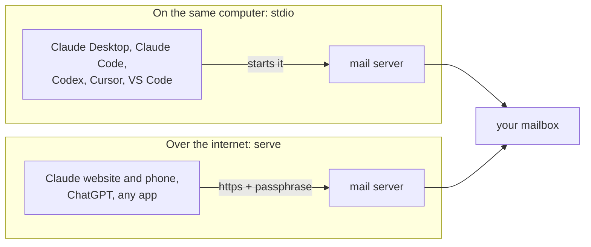

# Connect your AI app

There are two ways an AI app can reach this server:

- **On the same computer (`stdio`).** The app starts the server itself. No login and no web address needed. You need [option 1](setup-computer.md) installed and `setup` done.
- **Over the internet (`serve`).** The app connects to `https://your-address/mcp` and you log in once with your passphrase. You need [option 2](setup-hosting.md), [option 3](setup-own-server.md), or option 1 with the phone extra.



Menus in these apps change often. If a label below doesn't match what you see, look for "MCP", "Connectors" or "Tools" in the app's settings.

| App | Same computer | Over the internet | Tested by us |
|---|---|---|---|
| [Claude Code](#claude-code) | Yes | Yes | Configuration accepted (same computer); the login was tested with an equivalent client |
| [Claude Desktop](#claude-desktop) | Yes | Yes, via claude.ai | Not yet |
| [Claude website and phone app](#claude-website-and-phone-app) | No | Yes | The login steps, with Claude's real return address, tested locally |
| [Codex](#codex) | Yes | Yes | Configuration accepted (both ways) |
| [ChatGPT](#chatgpt) | No | Yes | The login steps, with ChatGPT's real return address, tested locally |
| [Cursor](#cursor) | Yes | Yes | Not yet |
| [VS Code (Copilot)](#vs-code) | Yes | Yes | Not yet |
| [Gemini CLI](#gemini-cli) | Yes | Yes | Not yet |
| Any other MCP app | Usually | If it supports MCP login (OAuth) | No |

The server was also tested end to end with the official MCP Python client, both ways, against a real mailbox: login, listing the 15 tools and calling them.

## Before you start: the command path

Desktop apps sometimes can't find commands that your terminal finds. Get the full path once:

- Mac and Linux: `which selfhost-remote-mail-mcp` (usually `/Users/you/.local/bin/selfhost-remote-mail-mcp`)
- Windows: `where selfhost-remote-mail-mcp`

Use that full path wherever you see `/full/path/to/selfhost-remote-mail-mcp` below.

## Claude Code

Same computer:

```bash
claude mcp add mail -s user -- selfhost-remote-mail-mcp stdio
```

Over the internet:

```bash
claude mcp add mail -s user --transport http https://your-address/mcp
```

Then run `/mcp` inside Claude Code, choose `mail` and log in.

## Claude Desktop

Settings → Developer → **Edit Config** opens `claude_desktop_config.json`. Add:

```json
{
  "mcpServers": {
    "mail": {
      "command": "/full/path/to/selfhost-remote-mail-mcp",
      "args": ["stdio"]
    }
  }
}
```

Save, then quit and reopen Claude Desktop. To use the internet version instead, add it on the Claude website (below). Connectors you add there also show up in Claude Desktop.

## Claude website and phone app

You add the connector on the website, and the phone app picks it up. Custom connectors work on every plan; Free accounts can have one.

1. On [claude.ai](https://claude.ai), open **Settings → Connectors** (on some accounts it's under **Customize → Connectors**).
2. Click **Add custom connector**. Name: `Mail`. URL: `https://your-address/mcp`. Leave the advanced settings empty.
3. Click **Connect**. A page asks for your passphrase. With more than one mailbox, it also asks which ones Claude may use. Tick **Allow sending** only if Claude should send (otherwise it drafts and you send). Type your passphrase and click **Allow access**.
4. In a chat, turn the connector on from the tools menu.
5. Open the Claude phone app: the connector is already there.

> [!TIP]
> In the connector's settings, set `send_email` and `schedule_send` to **Always ask** (Needs approval). Then Claude can never send without you tapping yes.

## Codex

Same computer:

```bash
codex mcp add mail -- selfhost-remote-mail-mcp stdio
```

Over the internet:

```bash
codex mcp add mail --url https://your-address/mcp
```

```bash
codex mcp login mail
```

Both commands write to `~/.codex/config.toml`, which you can also edit by hand:

```toml
[mcp_servers.mail]
command = "selfhost-remote-mail-mcp"
args = ["stdio"]
```

## ChatGPT

ChatGPT only connects over the internet, through **developer mode**. Which plans can use it, and whether it allows sending (write actions), has changed several times during 2026. Check [OpenAI's developer mode page](https://help.openai.com/en/articles/12584461) for your plan.

1. **Settings → Apps & Connectors → Advanced settings →** turn on **Developer mode**. On Business, Enterprise and Edu plans an admin turns this on first.
2. **Create** a connector. URL: `https://your-address/mcp`. Authentication: **OAuth**.
3. Save, then type your passphrase on the login page that opens.

## Cursor

In `~/.cursor/mcp.json` (or Settings → MCP → Add):

```json
{
  "mcpServers": {
    "mail": { "command": "/full/path/to/selfhost-remote-mail-mcp", "args": ["stdio"] }
  }
}
```

Over the internet, use `"mail": { "url": "https://your-address/mcp" }` instead.

## VS Code

Run **MCP: Add Server** from the command palette, or put this in `.vscode/mcp.json`:

```json
{
  "servers": {
    "mail": { "type": "stdio", "command": "/full/path/to/selfhost-remote-mail-mcp", "args": ["stdio"] }
  }
}
```

Over the internet, use `"mail": { "type": "http", "url": "https://your-address/mcp" }`.

## Gemini CLI

In `~/.gemini/settings.json`:

```json
{
  "mcpServers": {
    "mail": { "command": "selfhost-remote-mail-mcp", "args": ["stdio"] }
  }
}
```

Over the internet, use `"mail": { "httpUrl": "https://your-address/mcp" }`.

## The icon

The server tells AI apps its name (**Selfhost Mail**) and an envelope icon, and the web version has the same icon as its favicon. Apps that show server icons use it. Not every app does yet.

## Is it working?

Ask your AI: *"Use the mail accounts tool."* It should answer with your address and folders. If not, see [troubleshooting.md](troubleshooting.md).

## If the login page refuses your app

Only apps from a list of known addresses may receive the login: Claude, ChatGPT and VS Code on the web, plus any app on your own computer (localhost). If another app shows "Redirect not allowed", add its domain to `ALLOWED_REDIRECT_HOSTS` ([settings.md](settings.md)).
