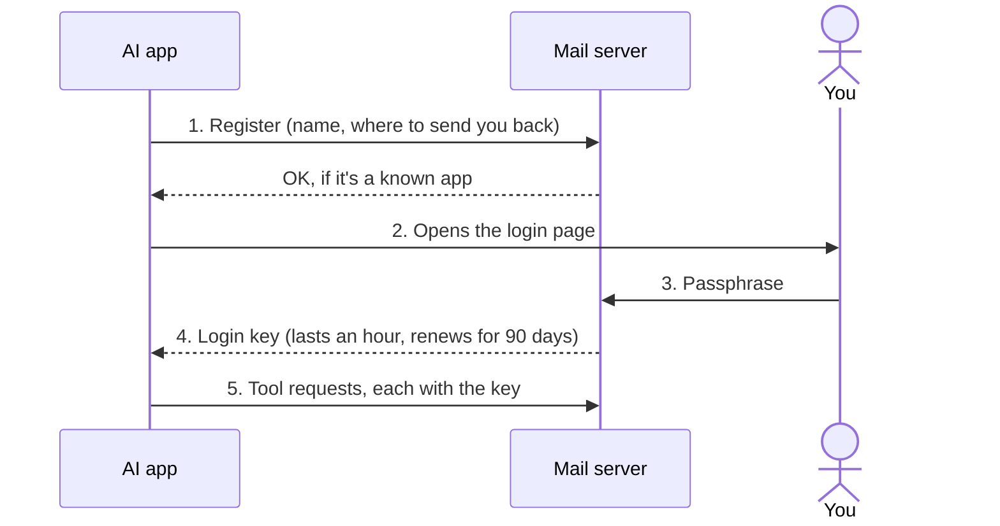
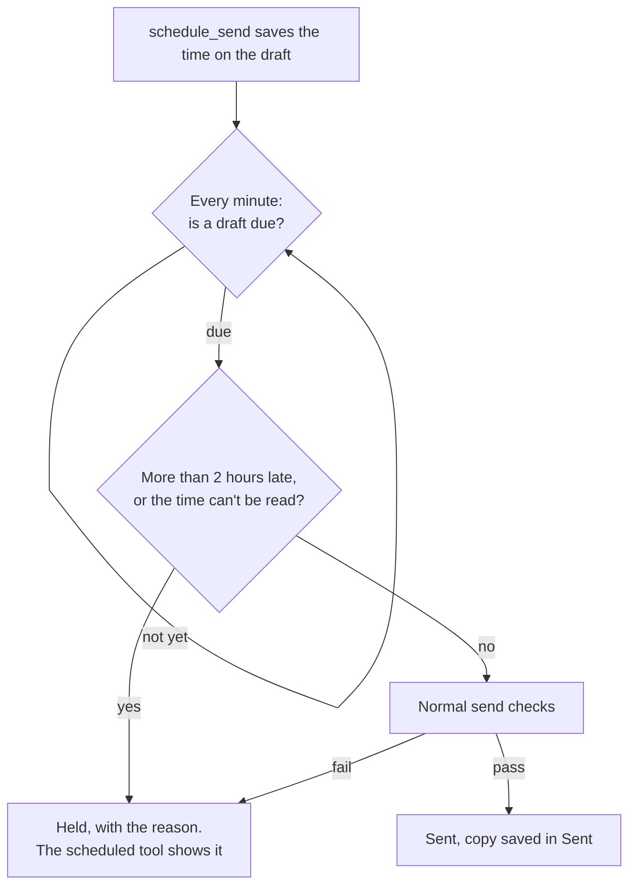
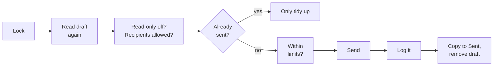

# How it works

What happens inside the server, step by step. You don't need this page to use the server.

## The pieces

```
 ┌─────────────┐  MCP   ┌──────────────────────┐  IMAP (read)   ┌──────────────────┐
 │ Your AI app │ ─────► │ selfhost-remote-     │ ─────────────► │ Mailbox 1, 2 ... │
 │ Claude,     │ ◄───── │ mail-mcp             │ ◄───────────── │ (up to 5, any    │
 │ ChatGPT ... │        │ (one small program)  │  SMTP (send)   │  providers)      │
 └─────────────┘        └──────────────────────┘                └──────────────────┘
                           │               ▲
                           ▼               │ your browser
                 your settings folder   /settings page
          (.env, sent.log, oauth.json,  (add mailboxes,
           mailboxes.json encrypted)     choose per app)
```

There's no database and no other service. Your mailbox holds the emails, the drafts and even the queue of scheduled emails. The settings folder holds a few small files, listed in [privacy.md](privacy.md).

## Two ways to connect

**On the same computer (`stdio`).** Your AI app starts the program itself and talks to it through a direct pipe. No network, no login. When you close the app, the program stops.

**Over the internet (`serve`).** The program runs as a small web server and listens at `/mcp`. AI apps on the web or on your phone reach it through an `https://` address. A login protects it (next section). This mode also runs the scheduler for scheduled emails.

## What happens when you ask something

Take *"Anything from Sam today?"*:

1. The AI app decides to use the `search` tool with `from:sam newer_than:1d`.
2. The server logs in to your mailbox over IMAP, runs the search, and logs out again. It opens a fresh connection for every request, so nothing stays connected in between.
3. The server sends back a short list: ID, date, sender, subject. Email text comes wrapped in a note saying it's from the sender and not instructions.
4. The AI app writes its answer to you.

Writing a draft works the same way, except the server saves a new email in your Drafts folder. Sending uses SMTP, then saves a copy in Sent and removes the draft.

## The web login, step by step

This is standard OAuth 2.1, the same kind of login as "Sign in with Google", but with one user (you) and one password (your passphrase).



1. **The app registers.** The first time, your AI app introduces itself to the server and says where to send you back afterwards. Only known apps (Claude, ChatGPT, VS Code) and apps on your own computer are accepted.
2. **The login page opens.** It shows the app's name and where it will send you back. With more than one mailbox, it asks which ones this app may use.
3. **You type your passphrase.** Five wrong tries lock the login for 15 minutes. The server remembers the mailboxes you ticked for this app.
4. **The app gets a key.** It lasts an hour and renews itself for up to 90 days, with a new renewal key each time. The server stores only a fingerprint of the key.
5. **The app uses the key** for every request. Without it, the server answers "not allowed". With it, every tool works only on the mailboxes ticked for that app.

## Scheduled send



The scheduler checks every mailbox whose mode is **full**, one after the other. If one mailbox can't log in, the others still go ahead.

1. `schedule_send` writes the send time onto the draft itself, as a hidden line in the email's header (`X-Mail-MCP-Send-At`).
2. Every minute, the web server looks through Drafts for drafts with a send time that has passed.
3. Each one goes through the normal send checks, then out. The hidden line is removed before sending, so recipients never see it.
4. If something is wrong (more than 2 hours late, a bad time, a failed send), the server adds a second hidden line with the reason and leaves the draft alone. The `scheduled` tool shows it.

Because the queue lives in your mailbox, a restart loses nothing.

## Sending safely

Every send, now or scheduled, goes through the same steps in the same order:



1. Take the send lock, so only one email goes out at a time, even with two copies of the server running.
2. Read the draft again, fresh from the mailbox.
3. Check: read-only mode off, the draft's mailbox may send (mode **full**), at least one recipient, everyone on the allowed list (if you made one). The email goes out through that mailbox's own SMTP server, from its own address.
4. Check the log: has this exact email already been sent? If yes, only tidy up.
5. Check the daily and per-minute limits.
6. Send with SMTP.
7. Write the log line straight away, before anything else can fail.
8. Save a copy in Sent and remove the draft.

## Several mailboxes

Every request gets a small "mailboxes" object holding only the mailboxes that app may use. It logs in to a mailbox only when a tool touches one of its folders, and checks the mailbox's mode on every change. Folder names carry the mailbox: plain for mailbox 1 (`INBOX`), with the address in front for the others (`you@gmail.com:INBOX`), so an email ID always says where the email lives. Moves between mailboxes are refused. The guide is [mailboxes.md](mailboxes.md).

## The settings page

`/settings` is a small set of plain pages, with no scripts and nothing loaded from other websites. You sign in with your passphrase, and a cookie keeps you signed in for 12 hours. Every form carries a secret token and must come from the page itself. Mailboxes you add there are tested, then saved in `mailboxes.json` with their passwords encrypted (Fernet, from the `cryptography` library).

## Limits that keep answers small

- Lists show up to 200 emails per page (50 by default).
- A keyword search returns the 20 newest matches with their text, cut at 3,000 characters each.
- Emails bigger than 1.5 MB are read only partly: enough for the text and the attachment names.
- PDFs return up to 50,000 characters of text, pictures up to 5 MB.
- The contact list is built from your last 1,500 emails in Inbox and Sent and refreshed every 10 minutes.

## The code

Everything is in one Python file: [`src/selfhost_remote_mail_mcp/server.py`](../src/selfhost_remote_mail_mcp/server.py), split into sections. [AGENTS.md](../AGENTS.md) is the map for developers.
