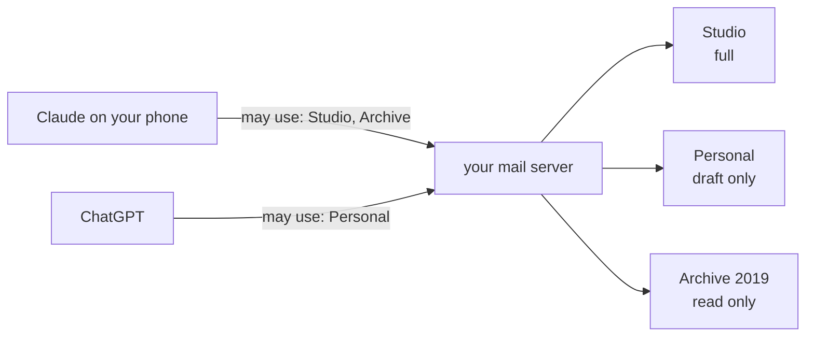
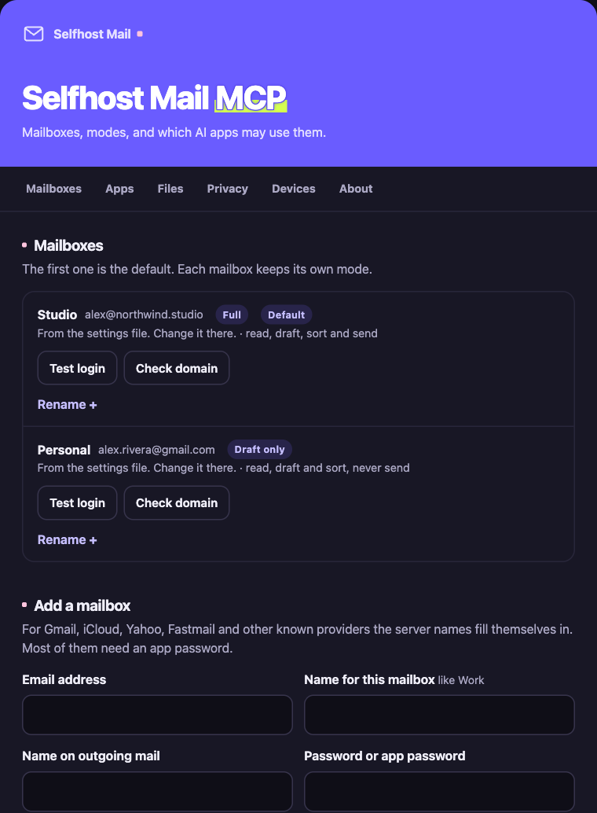

# Several mailboxes

One server can hold up to **5 mailboxes** (raise it with `MAX_MAILBOXES`). They can be at different providers: a Gmail, an iCloud and a work address on your own domain, side by side.



## Each mailbox gets a mode

| Mode | The AI may | Good for |
|---|---|---|
| **Full** | Read, search, draft, sort and send | Your main mailbox, with sending set to "Always ask" in your AI app |
| **Draft only** | Everything except sending | A mailbox where you always want to press send yourself |
| **Read only** | Read and search | Old addresses, shared inboxes, anything the AI should never touch |

The server enforces modes itself: a read-only mailbox can't be changed, and a draft-only one can't send, whatever the AI tries. `MAIL_READ_ONLY=on` still turns everything read-only at once.

## Each mailbox can have a name

Give mailboxes short names like **Work**, **Personal** or **Archive 2019**. You see them on the login page and the settings page, and the AI can use them: *"Draft this from Work"*, *"Search Personal for the train tickets"*.

## Three ways to add mailboxes

<p align="center"></p>

**1. The settings page** (web version only, the easiest). Open `https://your-address/settings` and type your passphrase. You can then:

- add a mailbox: the server names fill in for known providers, the login is tested before it's saved, and you pick a mode and a name,
- test any mailbox's login (nothing is sent),
- rename any mailbox,
- change or remove the mailboxes you added there,
- choose which mailboxes each connected AI app may use, or disconnect an app.

The settings page has a bar at the top with its sections:

| Section | What you can do there |
|---|---|
| **Mailboxes** | See each mailbox, test its login, check its domain, rename it, and edit or remove ones added on this page. **Add a mailbox** is right below |
| **Apps** | The AI apps that logged in: choose their mailboxes, whether they may send, or disconnect them |
| **Files** | A link to the upload page, for files to attach |
| **Privacy** | Turn photo location and document author removal on or off |
| **Devices** | Browsers signed in to these pages (sign any out), and every sign-in of the last 7 days. The log can be turned off |
| **AI changes** | Settings an AI app changed because you asked, in the last 30 days |
| **About** | Your version, the add-ons that are on, update status and what's new |

**2. The setup command** (on a computer). Run `selfhost-remote-mail-mcp setup` again and choose **add**. It asks for the address, a name, the mode and the password, and tests the login.

**3. The settings file or hosting variables.** Mailbox 1 uses the `MAIL_*` settings. Number the others:

```
MAIL_2_ADDRESS=you@gmail.com
MAIL_2_PASSWORD=your-app-password
MAIL_2_IMAP_HOST=imap.gmail.com
MAIL_2_SMTP_HOST=smtp.gmail.com
MAIL_2_MODE=draft
MAIL_2_LABEL=Personal
```

Server names and ports you leave out are copied from mailbox 1, which is handy for two addresses at the same provider. All the settings are in [settings.md](settings.md#several-mailboxes).

Mailboxes from the settings file show on the settings page too. You can test and rename them there, but change them in the file.

## Each AI app gets its own choice

When an AI app connects, the login page lists your mailboxes with tick boxes. Untick what that app shouldn't see.

<p align="center"></p>

- An app never sees, or even learns the address of, a mailbox you didn't tick.
- **"Allow ... to send email"** is a separate tick, not ticked by default. Not ticked: the app writes drafts, and you press send yourself in your mail app. Ticked: it can also press send for you.
- You can change an app's choice later on the settings page, under **Connected apps**.
- Apps on your own computer (`stdio`) use every mailbox, since nobody else can reach them.
- Apps that connected before you added a second mailbox keep seeing everything until you choose for them on the settings page, or they connect again.

## How the AI tells mailboxes apart

- **Mailbox 1 is the default.** Its folders have plain names: `INBOX`, `Sent`.
- **Other mailboxes' folders start with their address**: `you@gmail.com:INBOX`, `you@gmail.com:Sent`. Email IDs follow the same rule.
- **Replies and forwards** are drafted in the mailbox the email came from. If that mailbox is read-only, the reply goes to the first mailbox that may draft.
- **New emails** go to mailbox 1 unless you say which: *"from Personal"*.
- **Searching** looks in mailbox 1 by default. *"Search all my mailboxes"* covers every mailbox the app may use.
- **Emails can't move between mailboxes.** Forward them instead.
- **Limits:** each mailbox may send 40 emails a day (`SEND_DAILY_LIMIT`), and all mailboxes together 3 a minute (`SEND_MINUTE_LIMIT`). See [safety.md](safety.md#sending-limits).

## Check your domain

If a mailbox uses your own domain (like `you@yourname.com`), press **Check domain** next to it on the settings page. On a computer, `selfhost-remote-mail-mcp check` shows the same. The server looks up your domain's public records and says what each one means:

| Record | What it does | If it's missing |
|---|---|---|
| **MX** | Says where email for your domain goes | Email to you may bounce |
| **SPF** | Lists which servers may send as you | Your emails land in spam more often |
| **DKIM** | Signs your emails, so receivers know they're really from you | Your emails land in spam more often, and fakes are harder to spot |
| **DMARC** | Tells receivers what to do with fake emails that use your name | Anyone can pretend to be you |

Green is good, yellow works but could be better, red needs fixing. Each result says what to add at your domain company in plain words. The check changes nothing. It reads your domain's public records through your normal internet provider (not an outside service), and looks at the signature line of your last 20 sent emails to find your DKIM key.

Addresses at Gmail, iCloud, Outlook and other big providers are skipped, because the provider sets this up for you.

## Passwords of mailboxes added on the settings page

They're stored **encrypted** in `mailboxes.json` in the data folder. The key comes from the `MAIL_SECRET_KEY` setting. If that isn't set, the server makes a key file, `secret.key`, inside the data folder instead.

> [!IMPORTANT]
> Set `MAIL_SECRET_KEY` to a long random value, kept somewhere other than the data folder (your hosting company's secret variables, for example). Then a copy of the data folder alone can't unlock the passwords. If you change the key later, mailboxes added on the page have to be added again.

## Turning the settings page off

If you only use the settings file, set `SETTINGS_PAGE=off`. The page then doesn't exist at all.
