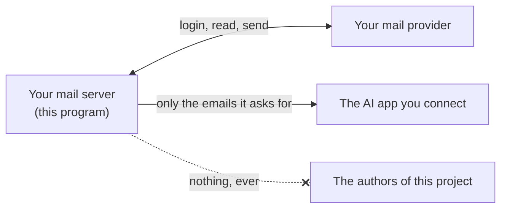

# Privacy

This page lists everything the server keeps, where it is, and who can see it. Your mail stays in your mailbox, the server keeps very little, and nothing goes to the authors of this project.

## What leaves your server

| Goes to | What | Why |
|---|---|---|
| Your mail provider (Gmail, iCloud, ...) | Your login, and the commands to read, move and send | That's how any mail app works |
| The AI app you connect (Claude, ChatGPT, ...) | The emails, attachments and contacts the AI asks for | So it can answer you. That company's own privacy rules apply to what it receives |
| Your internet provider's DNS, only when you press **Check domain** or run `check` | Your email domain's name, to read its public records | To check SPF, DKIM and DMARC. Nothing else is sent |
| GitHub, only if you turn on `UPDATE_CHECK` | A plain "which release is newest?" request, once a day | To tell you about updates. No login, address or usage is sent |
| GitHub, when you open the **About** tab of the settings page | Your browser loads the author's profile picture from GitHub | To show who made the project. Like any picture on the web, GitHub sees your browser's IP address. Nothing from your mail or settings is sent |
| The authors of this project | Nothing | No account, no tracking, no usage statistics |

The AI app only receives what it asks for through the tools, normally while you are chatting with it. Each request is one tool call, such as "list the Inbox" or "open this email".

## Encryption at a glance

Everything that travels is encrypted. Everything secret that's stored is encrypted or reduced to a fingerprint, except where that would add nothing.

**On the move**

| Between | Protected by |
|---|---|
| The server and your mail provider | Always encrypted: IMAP over SSL (port 993) and SMTP over SSL (465) or STARTTLS (587), TLS 1.2 or newer, and the provider's certificate is always checked. There is no unencrypted fallback |
| An AI app and the server, over the internet | HTTPS, from your hosting company, Caddy or a tunnel. The login system refuses plain `http://` addresses (except `localhost`) |
| Your browser and the login or settings pages | HTTPS (on a computer, `http://localhost`, which never leaves it). The pages tell browsers to never use plain HTTP again (HSTS), can't be shown inside other sites, and are never cached |
| An AI app and the server, on the same computer | A direct pipe between two programs; nothing goes over a network |

**Stored**

| What | How it's kept |
|---|---|
| Mail passwords, on a computer | In your **system keychain** (macOS Keychain, Windows Credential Manager, Linux Secret Service), which the operating system encrypts. `setup --terminal` offers this. Mailboxes added on the settings page are encrypted in the data folder instead (row below). If there's no keychain, in the private settings file |
| Mail passwords, on a hosting company | In the host's secret variables, which the host encrypts |
| Mail passwords added on the settings page | **Encrypted** (Fernet: AES with an authentication code) with `MAIL_SECRET_KEY` |
| Your passphrase | As a **one-way hash** if you use `set-passphrase` (PBKDF2, 600,000 rounds). `LOGIN_PASSPHRASE` keeps it as text, in your host's secret variables |
| Login keys of AI apps | Only **fingerprints** (SHA-256). A copied data folder can't be used to log in |
| Send log | Times, counts and **fingerprints** only, unless you turn on `SEND_LOG_DETAILS` |
| Your emails | **Not stored at all.** They stay in your mailbox |
| Files on the upload page (and from upload links) | **Encrypted** with `MAIL_SECRET_KEY`, file names too. Deleted 1 hour after first going into a draft, or after 24 hours |
| Mailbox names, app list, settings like limits | Plain text in private files (only your user account can read them). None of it is secret |

**Where encrypting more wouldn't help, and what to do instead**

- **The settings file on your own server** (`.env`) is a private file but not encrypted. Any key that unlocks it would have to sit on the same server, so it would add nothing. Turn on disk encryption on the server, or keep the passwords in your platform's secret store (Docker secrets, Coolify's variables).
- **`secret.key`**, made when `MAIL_SECRET_KEY` isn't set, sits next to the data it unlocks. Set `MAIL_SECRET_KEY` in your host's secret variables so the two are kept apart.
- **Your computer's disk:** turn on FileVault (Mac), BitLocker (Windows) or LUKS (Linux) so the settings folder is encrypted when the computer is off.

## Your files and tracking

- **Photos you attach lose their location** (GPS), camera and dates. iPhone HEIC photos only do once you agree to change them to JPG. **Documents lose the author's name**, last editor and company. On by default. See [attachments.md](attachments.md#private-details-are-removed).
- **Files you drop into the chat** pass through your AI app's own code sandbox (where the chat already keeps them) on their way to your server.
- **No tracking.** Many emails hide a tiny picture that tells the sender when and where you opened it. The server never loads pictures or links inside emails, so the sender never learns you opened it. The AI only gets the text.

## What the server keeps

Everything lives in one folder: `~/.config/selfhost-remote-mail-mcp/` on a computer, or `/data` in Docker and on hosting companies.

| File | What's in it | Who can read it |
|---|---|---|
| `.env` | Your settings, and the mail password unless it's in your system keychain | Only your user account (the server sets it to private). On hosting companies, it's their secret variables instead |
| `state/sent.log` (in Docker: `/data/sent.log`) | One line per email sent: the time, how many recipients, and two fingerprints (one of the email's ID, one of the mailbox it went from). Not who or what about, unless you turn on `SEND_LOG_DETAILS` | Only your user account |
| `state/oauth.json` (in Docker: `/data/oauth.json`) | The AI apps that connected to the web version, which mailboxes each may use, and fingerprints of their login keys. The keys themselves are never written down | Only your user account |
| `state/send.lock` | Empty. Makes sure two sends never happen at once | |
| `state/mailboxes.json` (in Docker: `/data/mailboxes.json`) | Mailboxes added on the settings page. Their passwords are **encrypted** | Only your user account. The key is `MAIL_SECRET_KEY`, or `secret.key` next to it if that isn't set |
| `state/labels.json` | The names you gave mailboxes, like "Work" | Only your user account |
| `state/prefs.json` | The switches on the settings page: photo location, document details, device log, update check | Only your user account |
| `state/changes.json` | What AI apps changed, for 30 days: the time, the app's name and the change | Only your user account |
| `state/sessions.json` | Browsers remembered on the settings page: a **fingerprint** of each sign-in, its device (like "iPhone · Safari"), network address and times | Only your user account |
| `state/signins.json` | The device log: each sign-in of the **last 7 days** (time, page, device, network address, right or wrong passphrase). Turn it off on the settings page or with `DEVICE_LOG=off`, which deletes it | Only your user account |
| `state/uploads/` | Files from the upload page, **encrypted**, until they're deleted (1 hour after first use, or 24 hours) | Only your user account |
| `state/secret.key` | The key that unlocks `mailboxes.json` and uploads, only when `MAIL_SECRET_KEY` isn't set | Only your user account |
| `state/update.json` | Only with the update check on: the newest version number and when it was checked | Only your user account |
| `signature.html`, `signature.md`, `templates/` | What you put there, or what your AI saved when you asked. A replaced or removed one is kept next to it as `.old` | You |

The server keeps **no copy of your emails**. Drafts and sent emails live in your mailbox, like with any mail app.

### About the fingerprints

A fingerprint here is a scrambled version (SHA-256) that can't be turned back into the original. The server can check "is this the same login key?" or "was this email already sent?" without storing the key or the email ID itself. If someone copies your `state` folder, they still can't log in.

## What the AI app sees

- **Emails it opens:** sender, recipients, date, subject, text, and a list of attachments.
- **Attachments it opens:** pictures, the text of PDFs, text files.
- **Contacts:** names and addresses from your recent Inbox and Sent mail, and how often you write to each other.
- **Your settings:** your address, your name, your folder names, and whether a signature, read-only mode or a sending allow-list is on. Never your password or passphrase.

To give the AI less, you can:

- turn on **read-only mode** (`MAIL_READ_ONLY=on`), so it can read but never change or send,
- point the server at a **separate mailbox** (for example a work-only address) instead of your main one,
- give a mailbox the **read-only** or **draft-only** mode,
- untick mailboxes for an app on the login page or the settings page, so that app never sees them.

## Your passphrase and password

- The **passphrase** is never stored as text if you use `set-passphrase`, only as a scrambled hash. If you use `LOGIN_PASSPHRASE` on a hosting company, it sits in their secret variables, like any other secret.
- The **mail password** has to be stored so the server can log in for you. Use an **app password** where your provider has them: you can delete it any time, and your real password is never stored anywhere.

## Logs

- The server prints short lines while it runs, for example "scheduler: sent Drafts#12 to 1 recipient(s)". On a hosting company these show in its log viewer. They contain no passwords, passphrases, login keys, email addresses, subjects or email text. The web server also logs each web request with the visitor's IP address, as web servers do. With `SEND_LOG_DETAILS=on` they also show subjects and recipients.
- Hosting companies keep those logs for a while under their own rules. If that matters to you, choose option 1 or 3.

## Deleting everything

1. On a computer, first run `selfhost-remote-mail-mcp service remove`, so it no longer starts at login. On a Mac, also delete `~/Library/Logs/selfhost-remote-mail-mcp.log`.
1. Delete the folder (`~/.config/selfhost-remote-mail-mcp/`, or the `/data` volume or disk).
2. Delete the app password at your mail provider.
3. Remove the connector from your AI apps.
