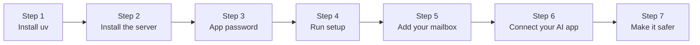

# Option 1: run it on your computer

Free, about 5 minutes. You get the same settings page as on a server, at `http://localhost:8765/settings`, and you add your mailbox there. Phone access is an optional extra at the end.



## Before you start

You need:

- a Mac, Windows or Linux computer,
- your email address and its password, or better, an **app password** ([email-providers.md](email-providers.md) shows how to make one),
- an AI app that supports MCP: Claude Desktop, Claude Code, Codex, Cursor, VS Code, Gemini CLI, OpenClaw, Hermes Agent and others.

You'll type a few commands. Copy and paste them exactly.

- **Mac:** open the **Terminal** app (press Cmd+Space, type "Terminal", press Enter).
- **Windows:** open **PowerShell** from the Start menu.
- **Linux:** open your terminal app.

## 1. Install uv

[uv](https://docs.astral.sh/uv/) installs Python tools without touching the rest of your computer.

- **Mac or Linux:** open Terminal and paste:

  ```bash
  curl -LsSf https://astral.sh/uv/install.sh | sh
  ```

- **Windows:** open PowerShell and paste:

  ```powershell
  powershell -ExecutionPolicy ByPass -c "irm https://astral.sh/uv/install.ps1 | iex"
  ```

Close the window and open a new one afterwards. To check it worked, run `uv --version`. You should see a version number, such as `uv 0.11.19`.

## 2. Install the mail server

```bash
uv tool install git+https://github.com/s17sh70x2jfl031ag/Selfhost-Remote-Mail-MCP
```

This adds one command, `selfhost-remote-mail-mcp`. To check, run `selfhost-remote-mail-mcp help`. You should see a short list of commands. To update later, run `selfhost-remote-mail-mcp update` ([updates.md](updates.md)). To remove it, run `uv tool uninstall selfhost-remote-mail-mcp`.

## 3. Get an app password (most providers)

> [!IMPORTANT]
> Gmail, iCloud, Yahoo, Fastmail and others don't let apps use your normal password. Make an app password first: [email-providers.md](email-providers.md#how-to-make-an-app-password) has the steps for each one.

## 4. Run setup

```bash
selfhost-remote-mail-mcp setup
```

It asks for two things (skipped if you already answered them):

1. **A passphrase**, 12 or more characters. It locks your settings page. Only a scrambled version (hash) is saved. Save it in your password manager (Apple Passwords, Google Password Manager, 1Password ...).
2. **Whether another copy of this server already uses the same mailboxes**, for example on a server or in Docker. Most people answer no. If you answer yes, this copy leaves scheduled emails and add-ons to the other one, so nothing happens twice.

Then setup starts the server in the background, makes it start by itself every time you log in, and opens your settings page in the browser:

```
The web version starts by itself when you log in (/Users/you/Library/LaunchAgents/com.selfhost-remote-mail-mcp.plist).

Your settings page: http://localhost:8765/settings (type your passphrase).
Add your mailbox on the settings page (or run: setup --terminal). Then connect your AI app: ...
```

If port 8765 is already taken (for example by Docker), setup picks the next free one and tells you, like `http://localhost:8766`.

> [!NOTE]
> Starting by itself works on a Mac and on Linux. On Windows, setup tells you to start it by hand for now: see [Keep it running in the background](#keep-it-running-in-the-background).

## 5. Add your mailbox

On the settings page, type your passphrase, then use **Add a mailbox**:

1. your email address and your name as people should see it,
2. the server names, filled in for you for well-known providers,
3. your password or app password,
4. its **mode**: full, draft only or read only. Trying it out? Choose **read only**, and change it later.

The login is tested before anything is saved (nothing is sent). Your password is stored encrypted on your computer. Add more mailboxes the same way, up to 5, each with its own mode, signature and a short name like *Work*. Pick which one is the default with **Make default** ([mailboxes.md](mailboxes.md)).

The same page also turns on add-ons, sets privacy options and shows which devices signed in.

<details>
<summary><b>Prefer the terminal?</b></summary>

`selfhost-remote-mail-mcp setup --terminal` asks for the mailbox in the terminal instead, then does the same as above. It can keep the password in your computer's keychain (Mac Keychain, Windows Credential Manager, Linux Secret Service), so the settings file holds no password. On a Mac, the first time the server reads it, macOS may ask whether it may use the keychain: choose **Always Allow**. Run it again to add another mailbox.

</details>

Your settings are kept in one private folder:

| System | Folder |
|---|---|
| Mac and Linux | `~/.config/selfhost-remote-mail-mcp/` |
| Windows | `C:\Users\<you>\.config\selfhost-remote-mail-mcp\` |

To test the logins again later: `selfhost-remote-mail-mcp check`. Besides the logins, it checks your domain's anti-spam records (if you use your own domain) and marks each line:

```
Testing you@yourname.com (full, nothing is sent)...
  logins work.
  OK  SPF: Set. Receivers can check which servers may send as you.
  TIP DMARC: Set to p=none: fake emails using your name are only watched, not stopped. ...
```

`OK` is fine, `TIP` works but could be better, `FIX` needs fixing ([mailboxes.md](mailboxes.md#check-your-domain)). To see which version you have: `selfhost-remote-mail-mcp version`.

### Optional: signature and templates

- **Signature:** each mailbox has its own **Signature** box on the settings page. Plain text, or HTML for a designed one.
- **Templates:** reusable emails with blanks to fill in, as `templates/*.md` files in the settings folder.

The [examples folder](../examples/) has five signature designs, two plain ones and five ready templates (thank you, follow-up, reschedule, invoice reminder, out of office). To use a signature design, open the file, put in your details, and paste it into a mailbox's **Signature** box. To use all templates:

```bash
cp -r examples/templates ~/.config/selfhost-remote-mail-mcp/
```

(Run that from a downloaded copy of this project, or copy the files by hand from GitHub.)

## 6. Connect your AI app

Most common apps are below. Every app is covered in [connect-your-ai.md](connect-your-ai.md).

- **Claude Code:** `claude mcp add -s user mail -- selfhost-remote-mail-mcp stdio`
- **Codex:** `codex mcp add mail -- selfhost-remote-mail-mcp stdio`
- **Claude Desktop:** see [connect-your-ai.md](connect-your-ai.md#claude-desktop).

Your AI app starts its own small copy of the server when it needs it. It uses the same settings and mailboxes as the one in the background, so you don't log in again.

Then ask: *"Use the mail tools: what's new in my inbox today?"* The AI should list your newest emails.

## 7. Make it safer (2 minutes)

1. In your AI app's settings, set the tools `send_email` and `schedule_send` to **Always ask**. Then nothing is sent without your yes.
2. Trying it for the first time? Give the mailbox the mode **read only**. The AI can then only read. Change it on the settings page when you're ready.

More options, such as only allowing certain recipients: [safety.md](safety.md#pick-a-safety-level).

## Optional: use it from your phone too

Your phone can't reach `localhost` on your computer. A free **tunnel** gives your computer a public `https://` address. The server and passphrase are already set up.

```
 Your phone          the internet           your computer
 (Claude app)  ──►  https://your-   ──►   tunnel  ──►  the server in the background  ──►  your mailbox
                    address/mcp                          (asks for your passphrase once)
```

> [!WARNING]
> Your computer must stay on and awake for the phone to work. If that's a problem, use [option 2](setup-hosting.md) instead.

### a. Get a fixed public address

Pick one. Both are free.

**Tailscale Funnel (easiest, no domain needed).** Install [Tailscale](https://tailscale.com/download), sign in, turn on Funnel in the admin console (DNS page), then run:

```bash
tailscale funnel --bg 8765
```

(If setup picked another port, like 8766, use that number here and below.)

It prints an address like `https://your-computer.your-tailnet.ts.net`. That address stays the same.

**Cloudflare Tunnel (if you own a domain on Cloudflare).** Follow Cloudflare's [create a tunnel](https://developers.cloudflare.com/cloudflare-one/connections/connect-networks/get-started/create-remote-tunnel/) guide and point a hostname such as `mail.yourdomain.com` at `http://localhost:8765`.

> Cloudflare's no-account "quick tunnel" (`cloudflared tunnel --url ...`) gets a new random address every time it starts. That's fine for a quick try, but your AI app would need reconnecting each time.

### b. Tell the server its address

Add one line to `~/.config/selfhost-remote-mail-mcp/.env`:

```
PUBLIC_URL=https://your-computer.your-tailnet.ts.net
```

Then restart it:

```bash
selfhost-remote-mail-mcp service restart
```

To check it works, open `https://your-address/health` in a browser: it shows `ok`.

### c. Add it to your AI app

Add `https://your-address/mcp` as a custom connector. On Claude, add it on the website (claude.ai), and it then shows up in the phone app too. See [connect-your-ai.md](connect-your-ai.md#claude-website-and-phone-app). When asked, type your passphrase.

## Keep it running in the background

On a Mac and on Linux, `setup` already did this. The server starts by itself when you log in and starts again if it stops. Control it with:

| Command | What it does |
|---|---|
| `selfhost-remote-mail-mcp service status` | Is it set to start at login, and is it running |
| `selfhost-remote-mail-mcp service restart` | Restart it, for example after changing the settings file |
| `selfhost-remote-mail-mcp service stop` | Stop it until your next login |
| `selfhost-remote-mail-mcp service start` | Start it again |
| `selfhost-remote-mail-mcp service remove` | It no longer starts by itself. Your settings and mailboxes are kept |
| `selfhost-remote-mail-mcp service install` | Set it up again, for example if you installed before this existed |

Its log: on a Mac `~/Library/Logs/selfhost-remote-mail-mcp.log`, on Linux `journalctl --user -u selfhost-remote-mail-mcp`.

While it runs, you have the settings page, the upload page, scheduled send and add-ons that work by themselves (out of office, webhooks). When your computer is off, those pause until it's back.

<details>
<summary><b>Windows</b></summary>

Not automatic yet. Start it by hand with `selfhost-remote-mail-mcp serve` (it runs while the window is open), or let it start at login:

1. Open **Task Scheduler** from the Start menu and click **Create Basic Task**.
2. Name it "Mail MCP" and choose **When I log on**.
3. Choose **Start a program**. Program: `selfhost-remote-mail-mcp`. Arguments: `serve`.
4. Finish. It starts the next time you log in. To start it now, right-click the task and choose **Run**.

</details>

## What we tested

| Step | Tested |
|---|---|
| Install with uv, `setup --terminal`, `check`, `stdio` against a real mailbox | Yes (macOS) |
| `setup` starting the server at login, the settings page sign-in, `service` status, restart, stop, start and remove, a taken port | Yes (macOS). Linux: tested with the system commands faked, not yet on a real Linux login |
| `serve` with the full passphrase login, as an AI app does it | Yes (macOS) |
| Claude Code and Codex accepting the server | Yes |
| Cloudflare quick tunnel | Tried: the link was created and connected, but its address didn't appear on the internet within 2.5 minutes. Quick tunnels have no uptime promise, which is one more reason to use Tailscale Funnel or a named tunnel |
| Tailscale Funnel, Cloudflare named tunnel, Windows and Linux background steps | Not yet: steps follow their official docs |
