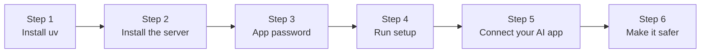

# Option 1: run it on your computer

Free, about 5 minutes. Your AI app on the same computer starts the server by itself whenever it needs it. Phone access is an optional extra at the end.



## Before you start

You need:

- a Mac, Windows or Linux computer,
- your email address and its password, or better, an **app password** ([email-providers.md](email-providers.md) shows how to make one),
- an AI app that supports MCP: Claude Desktop, Claude Code, Codex, Cursor, VS Code, Gemini CLI and others.

You'll type a few commands. Copy and paste them exactly.

- **Mac:** open the **Terminal** app (press Cmd+Space, type "Terminal", press Enter).
- **Windows:** open **PowerShell** from the Start menu.
- **Linux:** open your terminal app.

## 1. Install uv

[uv](https://docs.astral.sh/uv/) installs Python tools without touching the rest of your computer.

- **Mac or Linux:** open Terminal and paste:

  ```bash
  curl -LsSf https://astral.sh/uv/install.sh | sh
  ```

- **Windows:** open PowerShell and paste:

  ```powershell
  powershell -ExecutionPolicy ByPass -c "irm https://astral.sh/uv/install.ps1 | iex"
  ```

Close the window and open a new one afterwards. To check it worked, run `uv --version`. You should see a version number, such as `uv 0.11.19`.

## 2. Install the mail server

```bash
uv tool install git+https://github.com/s17sh70x2jfl031ag/Selfhost-Remote-Mail-MCP
```

This adds one command, `selfhost-remote-mail-mcp`. To check, run `selfhost-remote-mail-mcp help`. You should see a short list of commands. To update later, run `selfhost-remote-mail-mcp update` ([updates.md](updates.md)). To remove it, run `uv tool uninstall selfhost-remote-mail-mcp`.

## 3. Get an app password (most providers)

> [!IMPORTANT]
> Gmail, iCloud, Yahoo, Fastmail and others don't let apps use your normal password. Make an app password first: [email-providers.md](email-providers.md#how-to-make-an-app-password) has the steps for each one.

## 4. Run setup

```bash
selfhost-remote-mail-mcp setup
```

It asks for:

1. your email address,
2. your name as people should see it,
3. the server names, filled in for you for well-known providers,
4. your login name, only if it isn't your email address,
5. your password or app password (hidden while you type).

Then it tests the login and asks: **"Keep the password in your system keychain (encrypted) instead of the settings file?"** Press Enter for yes. Your Mac, Windows or Linux computer then keeps it encrypted, and the settings file holds no password at all. (On a Mac, the first time the server reads it, macOS may ask whether it may use the keychain: choose **Always Allow**.)

Everything else is saved in one private folder. Nothing is sent during the test. When it works, you see:

```
Testing the login (nothing is sent)...
IMAP and SMTP logins work.

Saved. Optional extras in /Users/you/.config/selfhost-remote-mail-mcp: signature.html (or signature.md) and templates/*.md.
```

If the login fails, setup tells you what went wrong and asks whether to save anyway. The usual fix is an app password; see [troubleshooting.md](troubleshooting.md).

The folder is:

| System | Folder |
|---|---|
| Mac and Linux | `~/.config/selfhost-remote-mail-mcp/` |
| Windows | `C:\Users\<you>\.config\selfhost-remote-mail-mcp\` |

To test again later: `selfhost-remote-mail-mcp check`.

### Optional: signature and templates

Put these in the same folder:

- `signature.md` (plain text) or `signature.html` (with formatting): added under every draft.
- `templates/*.md`: reusable emails with blanks to fill in.

The [examples folder](../examples/) has five signature designs, two plain ones and five ready templates (thank you, follow-up, reschedule, invoice reminder, out of office). For example, to use the minimal signature and all templates:

```bash
cp examples/signatures/minimal.html ~/.config/selfhost-remote-mail-mcp/signature.html
cp -r examples/templates ~/.config/selfhost-remote-mail-mcp/
```

(Run that from a downloaded copy of this project, or copy the files by hand from GitHub.)

### More mailboxes

Run `selfhost-remote-mail-mcp setup` again and choose **add**. Each extra mailbox gets a mode (full, draft only or read only) and a name like *Personal*. Up to 5 in all; see [mailboxes.md](mailboxes.md).

## 5. Connect your AI app

Most common apps are below. Every app is covered in [connect-your-ai.md](connect-your-ai.md).

- **Claude Code:** `claude mcp add mail -- selfhost-remote-mail-mcp stdio`
- **Codex:** `codex mcp add mail -- selfhost-remote-mail-mcp stdio`
- **Claude Desktop:** see [connect-your-ai.md](connect-your-ai.md#claude-desktop).

Then ask: *"Use the mail tools: what's new in my inbox today?"* The AI should list your newest emails.

## 6. Make it safer (2 minutes)

1. In your AI app's settings, set the tools `send_email` and `schedule_send` to **Always ask**. Then nothing is sent without your yes.
2. Trying it for the first time? Add `MAIL_READ_ONLY=on` to the settings file (`~/.config/selfhost-remote-mail-mcp/.env`). The AI can then only read. Change it to `off` when you're ready.

More options, such as only allowing certain recipients: [safety.md](safety.md#pick-a-safety-level).

## Optional: use it from your phone too

Your phone can't reach your computer directly. Two pieces make it work:

1. the server runs in **web mode** (`serve`) with a login passphrase, and
2. a free **tunnel** gives it a public `https://` address.

```
 Your phone          the internet           your computer
 (Claude app)  ──►  https://your-   ──►   tunnel  ──►  selfhost-remote-mail-mcp serve  ──►  your mailbox
                    address/mcp                          (asks for your passphrase once)
```

> [!WARNING]
> Your computer must stay on and awake for the phone to work. If that's a problem, use [option 2](setup-hosting.md) instead.

### a. Choose a passphrase

```bash
selfhost-remote-mail-mcp set-passphrase
```

Use 12 or more characters. Only a scrambled version (hash) is saved. You type the passphrase once when your AI app connects. Save it in your password manager (Apple Passwords, Google Password Manager, 1Password ...) with your server's address, so your phone fills it in for you.

### b. Get a fixed public address

Pick one. Both are free.

**Tailscale Funnel (easiest, no domain needed).** Install [Tailscale](https://tailscale.com/download), sign in, turn on Funnel in the admin console (DNS page), then run:

```bash
tailscale funnel --bg 8765
```

It prints an address like `https://your-computer.your-tailnet.ts.net`. That address stays the same.

**Cloudflare Tunnel (if you own a domain on Cloudflare).** Follow Cloudflare's [create a tunnel](https://developers.cloudflare.com/cloudflare-one/connections/connect-networks/get-started/create-remote-tunnel/) guide and point a hostname such as `mail.yourdomain.com` at `http://localhost:8765`.

> Cloudflare's no-account "quick tunnel" (`cloudflared tunnel --url ...`) gets a new random address every time it starts. That's fine for a quick try, but your AI app would need reconnecting each time.

### c. Tell the server its address and start it

Add one line to `~/.config/selfhost-remote-mail-mcp/.env`:

```
PUBLIC_URL=https://your-computer.your-tailnet.ts.net
```

Then start it:

```bash
selfhost-remote-mail-mcp serve
```

It keeps running while the window is open. To start it automatically, see [Keep it running](#keep-it-running-in-the-background) below.

### d. Add it to your AI app

Add `https://your-address/mcp` as a custom connector. On Claude, add it on the website (claude.ai), and it then shows up in the phone app too. See [connect-your-ai.md](connect-your-ai.md#claude-website-and-phone-app). When asked, type your passphrase.

## Keep it running in the background

Only needed for phone access or **scheduled send**. Scheduled emails go out only while `serve` is running.

<details>
<summary><b>Mac</b></summary>

Save this as `~/Library/LaunchAgents/com.selfhost-remote-mail-mcp.plist`, replacing `YOU` with your Mac user name (run `which selfhost-remote-mail-mcp` to check the path):

```xml
<?xml version="1.0" encoding="UTF-8"?>
<!DOCTYPE plist PUBLIC "-//Apple//DTD PLIST 1.0//EN" "http://www.apple.com/DTDs/PropertyList-1.0.dtd">
<plist version="1.0">
<dict>
  <key>Label</key><string>com.selfhost-remote-mail-mcp</string>
  <key>ProgramArguments</key>
  <array>
    <string>/Users/YOU/.local/bin/selfhost-remote-mail-mcp</string>
    <string>serve</string>
  </array>
  <key>RunAtLoad</key><true/>
  <key>KeepAlive</key><true/>
  <key>StandardErrorPath</key><string>/tmp/selfhost-remote-mail-mcp.log</string>
</dict>
</plist>
```

Start it with `launchctl load ~/Library/LaunchAgents/com.selfhost-remote-mail-mcp.plist`. Stop it with `launchctl unload` and the same path.

</details>

<details>
<summary><b>Windows</b></summary>

1. Open **Task Scheduler** from the Start menu and click **Create Basic Task**.
2. Name it "Mail MCP" and choose **When I log on**.
3. Choose **Start a program**. Program: `selfhost-remote-mail-mcp`. Arguments: `serve`.
4. Finish. It starts the next time you log in. To start it now, right-click the task and choose **Run**.

</details>

<details>
<summary><b>Linux</b></summary>

Save this as `~/.config/systemd/user/selfhost-remote-mail-mcp.service`:

```ini
[Unit]
Description=Selfhost-Remote-Mail-MCP

[Service]
ExecStart=%h/.local/bin/selfhost-remote-mail-mcp serve
Restart=always

[Install]
WantedBy=default.target
```

Then run `systemctl --user enable --now selfhost-remote-mail-mcp`.

</details>

## What we tested

| Step | Tested |
|---|---|
| Install with uv, `setup`, `check`, `stdio` against a real mailbox | Yes (macOS) |
| `serve` with the full passphrase login, as an AI app does it | Yes (macOS) |
| Claude Code and Codex accepting the server | Yes |
| Cloudflare quick tunnel | Tried: the link was created and connected, but its address didn't appear on the internet within 2.5 minutes. Quick tunnels have no uptime promise, which is one more reason to use Tailscale Funnel or a named tunnel |
| Tailscale Funnel, Cloudflare named tunnel, Windows and Linux background steps | Not yet: steps follow their official docs |
