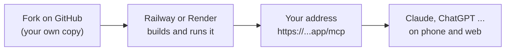

# Option 2: run it on a hosting company

Always on, works from your phone, no terminal. About 10 minutes. You pay the hosting company directly, about $5 to $8 a month. Nobody else, including the authors of this project, sees your password.

You need:

- a free [GitHub](https://github.com) account (to make your own copy of this project),
- your mail settings: address, app password, IMAP and SMTP server ([email-providers.md](email-providers.md)),
- a login passphrase you make up, 12 or more characters. You type it once when your AI app connects. Save it in your password manager (Apple Passwords, Google Password Manager, 1Password ...) with your server's address, so your phone fills it in for you.



First, click **Fork** at the top of this project's GitHub page. That gives you your own copy, which the hosting company builds from.

## Railway (about $5 a month)

1. Sign up at [railway.com](https://railway.com) with your GitHub account and choose the **Hobby** plan ($5 a month, including $5 of usage, which this server stays well within).
2. **New Project → Deploy from GitHub repo →** pick your fork. Railway finds the `Dockerfile` by itself and starts building. The first build fails or waits until step 3 is done; that's normal.
3. Open the service, go to **Variables**, and add these (Raw Editor lets you paste them all at once):

   ```
   MAIL_ADDRESS=you@example.com
   MAIL_PASSWORD=your-app-password
   IMAP_HOST=imap.example.com
   SMTP_HOST=smtp.example.com
   MAIL_NAME=Your Name
   LOGIN_PASSPHRASE=a long passphrase only you know
   MAIL_SECRET_KEY=a second long random value
   PORT=8765
   ```

   `MAIL_SECRET_KEY` encrypts mailboxes you add later on the settings page. Make it long and random, and never change it.

   Ports default to 993 (IMAP) and 465 (SMTP). Add `IMAP_PORT` or `SMTP_PORT` only if your provider uses others.
4. **Settings → Networking → Generate Domain.** If it asks which port, type **8765**. You get an address like `https://your-mail.up.railway.app`. The server picks it up by itself.
5. **Add a volume** (right-click the service, or the command palette: *Add Volume*) with mount path **`/data`**. Without it everything still works, but after each restart you log in again, the send limits start from zero, and your signature, templates, uploads and settings-page changes are lost.
6. Wait for the deploy to turn green, then open `https://your-mail.up.railway.app/health`. It should say `ok`.

## Render (about $7 a month plus $0.25 for the disk)

1. Sign up at [render.com](https://render.com) with your GitHub account.
2. **New → Blueprint →** pick your fork. Render reads `render.yaml` and sets up a web service with a 1 GB disk at `/data`.
3. Fill in the blanks it asks for: `MAIL_ADDRESS`, `MAIL_PASSWORD`, `IMAP_HOST`, `SMTP_HOST`, `LOGIN_PASSPHRASE`, `MAIL_NAME`.
4. Click **Apply**. The address (like `https://selfhost-remote-mail-mcp.onrender.com`) is picked up by itself.
5. Open `https://your-address.onrender.com/health`. It should say `ok`.

> Render's free plan can't keep a disk and falls asleep when idle, which breaks scheduled send. So `render.yaml` uses the smallest paid instance.

## Any other hosting company

Railway and Render have step-by-step instructions above, but you can use any service that runs a **Docker container**. Pick the one you like, check it against this list, and follow its own guide for deploying a Dockerfile.

> [!TIP]
> Using an AI coding agent (Claude Code, Codex, Cursor and others)? Tell it which service you chose, and ask it to deploy this project there. [AGENTS.md](../AGENTS.md#deploying-for-a-user) gives it a checklist, so it asks about costs first, keeps your passwords in the service's secret settings, and tests the result.

**What any service needs**

| Need | Why | Usually called |
|---|---|---|
| Build from the `Dockerfile` | That's the server | "Deploy from GitHub" or "Dockerfile build" |
| Web traffic to port **8765** | Where the server listens | `PORT=8765`, "internal port" or "target port" |
| HTTPS with a public address | AI apps only connect over HTTPS | Usually automatic. Set `PUBLIC_URL` to that address |
| A **persistent volume** at `/data` | Keeps logins, the send log and mailboxes added on the settings page | "Volume", "disk" or "persistent storage" |
| **Always on** | Scheduled emails go out only while it runs | Turn off "scale to zero", "sleep" or "auto stop" |
| **One** copy | Two copies with separate data could send a scheduled email twice | "Instances", "replicas" or "scale" = 1 |
| Secret variables | Mail passwords, `LOGIN_PASSPHRASE`, `MAIL_SECRET_KEY` | "Secrets", "environment" or "variables" |

**Some options, and what their docs say** (October 2026; services change, so check)

| Service | Persistent volume | Can stay always on | Good to know |
|---|---|---|---|
| [Railway](https://docs.railway.com/reference/volumes) | Yes | Yes | Steps above. Hobby plan $5 a month |
| [Render](https://render.com/docs/disks) | Yes, on paid plans | Yes, on paid plans | Steps above, `render.yaml` included |
| [Fly.io](https://fly.io/docs/volumes/overview/) | Yes | Yes (`auto_stop_machines = "off"`) | Command-line tool `fly`. `fly launch` finds the Dockerfile |
| [Northflank](https://northflank.com/docs/v1/application/databases-and-persistence/add-a-volume) | Yes | Yes | Deploys from a GitHub fork |
| [Koyeb](https://www.koyeb.com/docs/reference/volumes) | In preview, for testing only | Yes | Runs fine; without a lasting volume, logins reset on restart |
| [DigitalOcean App Platform](https://docs.digitalocean.com/products/app-platform/how-to/store-data/) | No | Yes | Runs fine; logins and send limits reset on each restart |
| [Google Cloud Run](https://docs.cloud.google.com/run/docs/configuring/min-instance) | No simple disk | With minimum instances = 1 | Same trade-off as App Platform |
| Any VPS (Hetzner, DigitalOcean Droplet, Vultr, Akamai, IONOS, OVHcloud, Oracle Cloud free) | Yes | Yes | [Option 3](setup-own-server.md), with full control |
| Your own Coolify, Dokploy or CapRover | Yes | Yes | [Option 3](setup-own-server.md#already-have-a-reverse-proxy-coolify-dokploy-or-similar) |

Without a persistent volume the server still works: you log in again after each restart, the send limits start from zero, and everything changed on the settings page or by asking the AI is lost: mailboxes added there, signature, templates, uploads, the privacy and update switches (mailboxes in the variables stay).

## Check that it works

1. Open your address plus `/health` in a browser, for example `https://your-mail.up.railway.app/health`. It should show `ok`.
2. If it doesn't, open the service's **Logs** (Railway: the **Deployments** tab, Render: the **Logs** tab). The last lines usually say what's wrong, for example a mail password the server couldn't log in with. See [troubleshooting.md](troubleshooting.md).

## More mailboxes

Open `https://your-address/settings`, type your passphrase, and use **Add a mailbox**. Or add `MAIL_2_...` variables ([mailboxes.md](mailboxes.md)). Each mailbox gets a mode and a name, and each AI app only the mailboxes you tick.

## Make it safer

Add any of these to the Variables (Railway) or Environment (Render), then let it restart:

- `MAIL_READ_ONLY=on` while you try it: the AI can only read.
- `SEND_ALLOWED_RECIPIENTS=you@example.com,@yourcompany.com` to only ever send to people you list.

And in your AI app, set `send_email` and `schedule_send` to **Always ask**. More in [safety.md](safety.md).

## Connect your AI app

Your server address is your hosting address plus `/mcp`, for example `https://your-mail.up.railway.app/mcp`.

- **Claude (website, phone, desktop):** on claude.ai, add it as a custom connector. It then appears in the phone app too.
- **ChatGPT, Codex, Cursor, VS Code:** see [connect-your-ai.md](connect-your-ai.md).

When the app opens the login page, tick the mailboxes it may use (if you have more than one) and type your `LOGIN_PASSPHRASE`.

## Update to a newer version

Turn on the **Update from official releases** action in your fork, and new releases come in by themselves once a week; the host rebuilds. Or run it by hand from the Actions tab. See [updates.md](updates.md#on-a-hosting-company-railway-render-flyio-).

## Stop or remove it

- **Pause:** Railway: in the **Deployments** tab, remove the active deployment. Render: **Settings → Suspend Web Service**. A stored volume or disk may still cost a little while paused.
- **Remove for good:** delete the service (Railway: **Settings → Delete service**; Render: **Settings → Delete web service**), which also deletes its stored logins and send log. Then delete the app password at your mail provider and remove the connector from your AI apps.

## Optional extras

- **Time zone** for the send log and the times you see: add `TZ=Europe/London` (or [your zone](https://en.wikipedia.org/wiki/List_of_tz_database_time_zones)).
- **Signature:** add `MAIL_SIGNATURE=Your Name\nWhat you do · example.com` (`\n` starts a new line). It is added under every draft.
- **Templates and signature:** ask your AI, for example *"Save this as a template called thank-you"* or *"Change my signature"*. They're kept on the `/data` volume.
- **More settings:** [settings.md](settings.md).

## What we tested

| Step | Tested |
|---|---|
| The Docker image: builds, starts, passes its health check, keeps logins on a volume | Yes, with a real Docker run |
| Render's and Railway's ports and addresses | Yes, by faking their environment |
| `render.yaml` and the Railway steps | Checked against Render's and Railway's current docs and against other projects' working setups (October 2026) |
| The passphrase login over HTTPS, as Claude and ChatGPT do it | Yes, locally |
| A real deploy on Railway or Render | Not yet: needs an account. Please [report it](https://github.com/s17sh70x2jfl031ag/Selfhost-Remote-Mail-MCP/issues/new?template=bug_report.yml) if a step doesn't match what you see |
