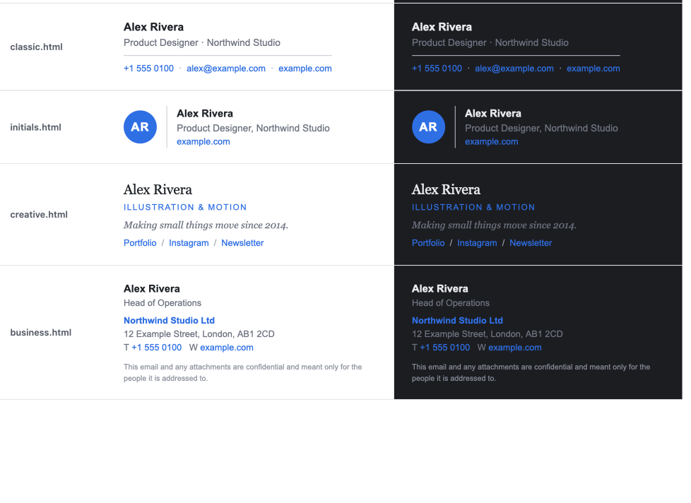

# Examples

Starter files to copy into your settings folder (`~/.config/selfhost-remote-mail-mcp/` on a computer, `/data` in Docker). Edit them to sound like you. The server never reads this folder itself. You can also just ask your AI: *"Change my signature to ..."* or *"Save this as a template called thank-you"*.

## Signatures

Pick one, put your own details in, and save it in your settings folder as **`signature.html`** (HTML designs) or **`signature.md`** (plain text). It's added under every draft. If both exist, the HTML one is used.

| File | Good for |
|---|---|
| `signatures/minimal.html` | Most people. Name, one line, one link |
| `signatures/classic.html` | Client work. Adds phone and email under a thin line |
| `signatures/initials.html` | A brand feel without a logo image: a coloured badge with your initials |
| `signatures/creative.html` | Artists, studios and freelancers. A line about your work and links to where people find it |
| `signatures/business.html` | Companies. Full address and a short confidentiality line |
| `signatures/plain-short.md` | Plain text, two lines |
| `signatures/plain-full.md` | Plain text with phone, email and website |

How they're built, so they look right everywhere:

- **Tables and inline styles only.** Outlook and Gmail ignore most other layout code.
- **Everyday fonts** (Arial, Georgia), so nobody gets a strange fallback.
- **No images.** Many mail apps block them, and logos often vanish in dark mode. `initials.html` gives you a brand mark without one.
- **Works in dark mode.** Your name takes the mail app's own text colour, and the blue and grey stay readable on light and dark backgrounds.
- **Readable as plain text.** The server makes a plain-text copy of every email; each design turns into clean lines, and links keep their address.

To change the colour, replace `#2f6fe4` (blue) with yours. Pick a middle shade: very dark colours disappear in dark mode, very light ones on white.

## Templates

| File | What it is |
|---|---|
| `templates/thank-you.md` | Thank someone for getting in touch |
| `templates/follow-up.md` | Nudge someone who hasn't replied |
| `templates/reschedule.md` | Move a meeting to another time |
| `templates/invoice-reminder.md` | Remind a client about an unpaid invoice |
| `templates/out-of-office.md` | Reply while you're away |

A template is a text file: an optional `Subject:` (and `To:`) line, a line with `---`, then the email.

Words in double curly brackets are blanks:

- `{{recipient_first_name}}`, `{{recipient_name}}` and `{{my_name}}` fill themselves in.
- Anything else, like `{{topic}}` or `{{due_date}}`, the AI asks you for or fills in from the conversation.

Don't end a template with your name: your signature is added after it.

Ask your AI: *"Use my follow-up template for Sam about the proposal."*
